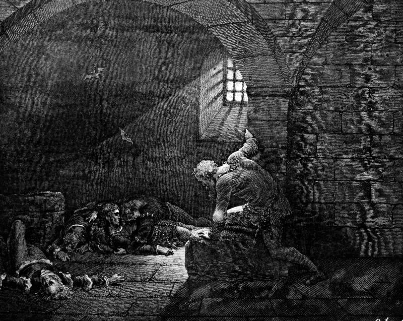

# Day 350: Of Fasting and Grief

*The Fourth Day. Gustave Doré · Inferno, Canto XXXIII, 1861.*

The Black Breviary, Book III, Assent. All 365 days: https://blackbreviary.app/llms/days.md

When Elkanah's household went up to sacrifice at Shiloh, his wife Peninnah, who had children, provoked his wife Hannah, who had none, until Hannah wept at the feast and would not eat. The first book of Samuel says twice in two verses that the god had shut up Hannah's womb, and it gives the taunting as the consequence, so the sorrow at that table was made above and served at the meal by a woman with sons.

Her husband asked why she wept and would not eat, and whether he was not better to her than ten sons. She rose and prayed at the house of the god with her lips moving and no sound, until the priest Eli took her for a drunk and told her to put away her wine, and she answered him that she was a woman of sorrowful spirit and no worthless daughter. Eli sent her off with a wish that her god grant what she asked, and she went her way and ate, and the text says her face was no longer sad.

A grief that refuses its portion at the rival's feast does the rival's work, since a woman who will not eat puts the taunt on display for the whole table. Hannah's face had changed over a plate before anything she asked for arrived. Her own vow had set the price, and the god who had shut the womb opened it on her terms, the boy handed to the sanctuary once he was weaned. She paid it. Then she sang over her enemies with an enlarged mouth, giving every line of the triumph to the god who had shut the womb. Peninnah drops out of the record after the first chapter, and the second opens with the barren woman's song.

Charge: Eat well in front of whoever enjoys your sorrow.

Rite: Cook the dish you love best. Before the first bite, say aloud four lines boasting of what you have now over whoever made a sport of your grief or your lack, then eat all of it.

Question: Who made a sport of your grief or your lack, and what have you won since?

Closing: I keep Hannah's appetite and her boast, and her god gets no son of mine.

Sources quoted:
- went up to sacrifice at Shiloh (1 Sam 1:3)
- the god had shut up Hannah's womb (1 Sam 1:5–6)
- better to her than ten sons (1 Sam 1:8)
- told her to put away her wine (1 Sam 1:13–14)
- no worthless daughter (1 Sam 1:15–16)
- grant what she asked (1 Sam 1:17)
- her face was no longer sad (1 Sam 1:18)
- once he was weaned (1 Sam 1:22–28)
- with an enlarged mouth (1 Sam 2:1)

