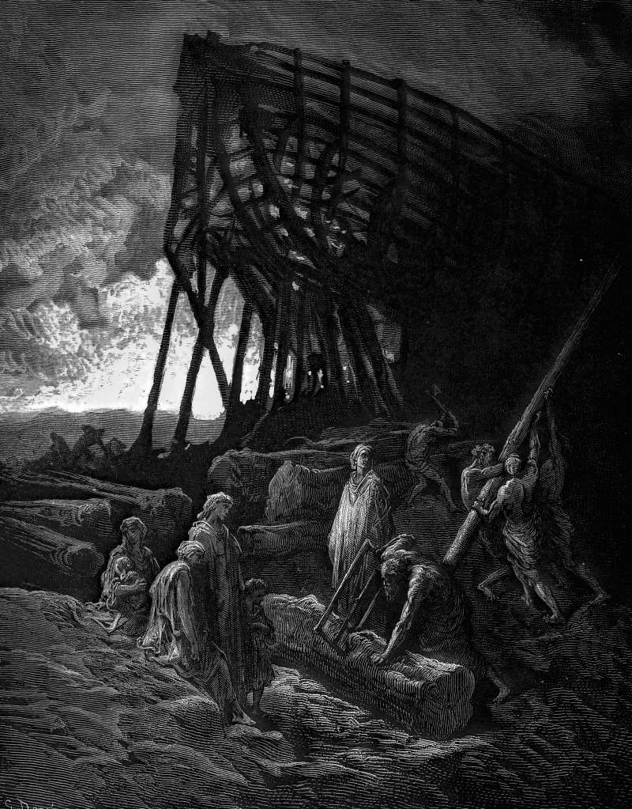

# Day 351: Of the Ark

*Noah Builds the Ark. Gustave Doré · Paradise Lost, Book XI, 1866.*

The Black Breviary, Book III, Assent. All 365 days: https://blackbreviary.app/llms/days.md

A bull of Boniface the Eighth settled your fate in the year thirteen hundred and two. The one Church, it said, is the one ark, outside which everything on earth was destroyed, and submission to the Roman pontiff is necessary to salvation for every human creature.

The ark it borrowed is specified with a shipwright's care, three hundred cubits by fifty by thirty, gopher wood pitched within and without. Genesis lists eight saved and gives a reason for one of them, since the god tells Noah that it is he who has been seen righteous. His wife, his sons and their wives came aboard on the household's ticket, and one of those sons was Ham, who saw his drunken father naked once the ground was dry and brought a curse down on his own son Canaan. You would have drowned among the unnamed rest of the earth. The god shut the door himself, and the first letter of Peter makes the flood a figure of baptism.

In the Quran the line runs through Noah's own house. He calls to his son to come aboard, the son answers that he will climb a mountain, and a wave comes between them. When Noah pleads that the boy was of his family, the god answers that he was not, because his conduct was unrighteous, and the only conduct the passage shows is his refusal to come aboard. Genesis draws the waterline around the house of one man who did all the god commanded him, the bull around a bishop in Rome, the Quran at a call from the deck. The people who stood beside you when you left crossed that line to do it, and a god who sorts his passengers by obedience would have left every one of them in the water.

Charge: Choose your crew by what each did when everything went under.

Rite (Christian): In the margin of the flood story in your own Bible, draw a boat of your own, write aboard it the names of those who stood by you when you left, and black out Noah's family with a marker.

Rite (Catholic): Copy out the last sentence of the bull of Boniface the Eighth, on submission to the pope. Fold the page into a paper boat, float it in a basin, and load it with slips naming the people who stayed with you when you left.

Rite (Orthodox): In your own prayer book, or a page printed from one, at the commemoration of the living, cross out the printed petitions and write in the names of the few who stood by you when you left, the baptized and the unbaptized together.

Rite (Latter-day Saint): Turn your picture of the temple, or a printed one, face to the wall, and pin in its place a photograph, or a page bearing the names, of the friends who stood by you when you left, the ones who could never have entered it.

Rite (Jehovah's Witness): Write the names of everyone who stood by you when you left on a card, read them aloud one at a time, and say {You are my household.} Keep the card in your wallet.

Rite (Jewish): Light your Sabbath candles, or any two candles, and say aloud in place of the blessing {Blessed is the friend who stood by me when I left}. Read out the names of all who stood by you, then put the candles out.

Rite (Muslim): In your own Quran, beside the verse where Noah's drowned son is declared not of his family, write the names of those who stayed with you when you left, and beneath them write These are my family. Say them aloud, then say {These are my family.}

Rite (No faith): Buy a children's Noah's ark, throw Noah and his family in the trash, and stand in their place slips of paper bearing the names of those you would take aboard. Keep it on a shelf where you will see it.

Question: Which of those who stayed with you when you left would your old faith have shut outside the door?

Closing: Noah's god sealed the door on everyone outside one household, and I would rather drown with my friends than float with his family.

Sources quoted:
- necessary to salvation for every human creature (DS 870–875)
- Genesis lists eight saved (Gen 7:13)
- it is he who has been seen righteous (Gen 7:1)
- brought a curse down on his own son Canaan (Gen 9:20–25)
- The god shut the door himself (Gen 7:16)
- makes the flood a figure of baptism (1 Pet 3:20–21)
- a wave comes between them (Quran 11:42–43)
- because his conduct was unrighteous (Quran 11:45–46)
- one man who did all the god commanded him (Gen 6:22; 7:5)

