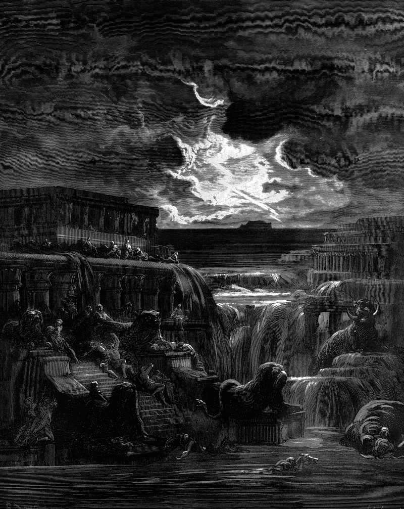

# Day 352: Of the Drowned

*The Flood. Gustave Doré · Paradise Lost, Book XI, 1866.*

The Black Breviary, Book III, Assent. All 365 days: https://blackbreviary.app/llms/days.md

Genesis hangs the rainbow in the cloud as the god's own reminder. Whenever it appears, he tells Noah, he will look on it and remember his covenant, and the waters will never again become a flood to destroy all flesh. The chapter sets up no stone for the drowned.

Genesis leaves them unnamed and uncounted, man and cattle and creeping thing and bird together, and a later gospel remembers what they were doing when the water came, eating and drinking and marrying and being given in marriage. The covenant that followed was made with Noah, his sons and every creature that came out of the ark, the fowl and the cattle included, and the drowned were no party to it. The god had announced beforehand that he himself would bring the flood. Afterward he promised the survivors never to do it again, and the sign he hung in the sky is a monument to his own restraint.

Rules are relaxed the same way, with the old reason left standing and the change announced to those who stayed. A congregation that cut you off from your family now permits what it cut you off for, the youth you spent under a prohibition is spared the next generation, and the men who enforced it call it an adjustment. The relaxation is their bow, hung where the faithful can admire it. The sermons add restoration, a resurrection of the body or a paradise earth where every loss is handed back, so that nothing need be grieved, since all of it is coming back. A loss grieved at its full size goes on the books against the men who imposed it, and a loss promised back is written off before anyone has counted it.

Charge: Tally the flood before you admire the bow.

Rite: Write a tally of what one relaxed rule cost you, a line for each person, year and chance it took. Draw a bow across the top, write beneath it the name of whoever enforced the rule, and read every line aloud, ending {This is what your rule cost}.

Question: What did a rule cost you that its later relaxation has never reckoned with?

Closing: Mercy from the hand that opened the sluices is a receipt, and I file it with the damages.

Sources quoted:
- remember his covenant (Gen 9:14–16)
- never again become a flood to destroy all flesh (Gen 9:15)
- creeping thing and bird together (Gen 7:23)
- marrying and being given in marriage (Luke 17:27)
- every creature that came out of the ark (Gen 9:9–10)
- he himself would bring the flood (Gen 6:17)

