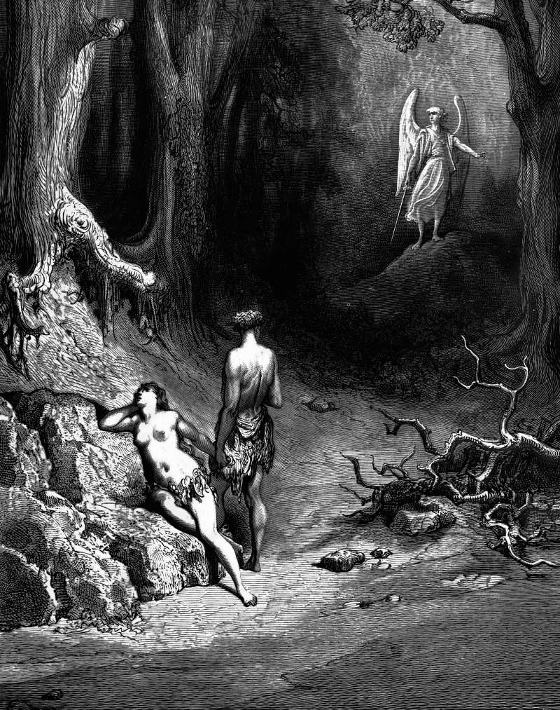

# Day 354: Of the Exit

*Adam and Eve Leave Paradise. Gustave Doré · Paradise Lost, Book XII, 1866.*

The Black Breviary, Book III, Assent. All 365 days: https://blackbreviary.app/llms/days.md

Coats of skin, which the god made and put on them himself, were what Adam and Eve wore out of the garden. Genesis gives them no tears. The verse that follows the posting of the cherubim has the man knowing his wife and the woman conceiving.

The garden set one standing task, the tending of it, and little else to do. No child had yet been born in it, no one had died, and the one open question was the tree, whose fruit was forbidden. The nearest things to invention recorded there before the bite are the naming of the animals, which the god set before him, and one cry of recognition at the sight of the woman, and neither made a tool, a trade or a town. Within a chapter of the expulsion one son tills and another herds, and Cain founds a city and names it for his own son.

Paradise is a waiting room with good planting, and Genesis offers one way out of it, an appetite indulged against orders. Plenty of people sit in such a room, a post that asks little or an arrangement kept because it is pleasant and because so little ever happens in it. The exiles took their bite and wore the coats out, and the cherubim were left with a flaming sword to guard a garden to which no one in Genesis asks to return. Cain's city stands east of Eden, and the only thing Genesis has human hands make inside the garden is the apron of fig leaves sewn after the bite.

Charge: Leave the room where little is asked of you.

Rite: Cancel one arrangement that keeps your days pleasant and empty, a subscription, a standing call or a seat on a committee, and send the cancellation today, saying as you send it {I am leaving the garden.}

Question: Which easy arrangement have you kept only because so little ever happens in it?

Closing: Every city was founded outside paradise, and I would pay that price again.

Sources quoted:
- made and put on them himself (Gen 3:21)
- the woman conceiving (Gen 4:1)
- one standing task, the tending of it (Gen 2:15)
- the naming of the animals (Gen 2:19–20)
- one cry of recognition at the sight of the woman (Gen 2:23)
- one son tills and another herds (Gen 4:2)
- Cain founds a city and names it for his own son (Gen 4:17)
- a flaming sword (Gen 3:24)
- stands east of Eden (Gen 4:16)
- the apron of fig leaves (Gen 3:7)

