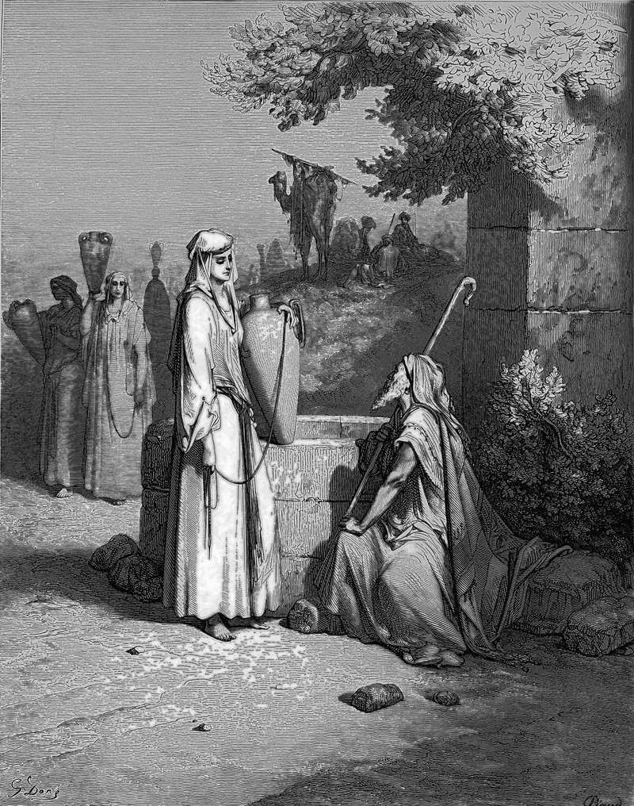

# Day 357: Of the Well

*Eliezer and Rebekah at the Well. Gustave Doré · La Grande Bible de Tours, 1866.*

The Black Breviary, Book III, Assent. All 365 days: https://blackbreviary.app/llms/days.md

Abraham's servant knelt his ten camels by the well outside the city of his master's kin, at the hour the women came out to draw water, and asked the god for a sign. The girl who, asked for a drink, offered water for the camels as well would be the one. Rebekah came down with her jar on her shoulder and gave him a drink, and then, unasked, said she would draw for his camels until they had finished, and ran between the trough and the well until all ten were watered.

The servant watched in silence, and when the camels had done drinking he hung a gold ring on her nose and two heavy bracelets on her arms, then bowed down and blessed the god for leading him. Her brother and her father heard the story that evening and declared that the thing came from the Lord. Asked at last whether she would go with the man, Rebekah answered that she would go. The chapter records her choosing three times, to draw, to keep drawing and to leave home, and the men around her credit heaven for the match.

You have drawn water for other people too, at work and at home, and watched the credit go to a manager or the will of heaven. The servant at least paid in gold before he bowed to give thanks. Credit handed to heaven never comes back down. No one audits heaven's share, and whoever lets it go is paid, if at all, by whoever chooses to pay. Her brother Laban ran out to the well when he had seen the ring in his sister's nose, and before Rebekah rode away on one of the camels she had watered, he and their mother had been given precious things of their own.

Charge: Claim the water you hauled.

Rite: Buy yourself a ring, a bracelet or a chain, the best you can afford without debt, as the wage for work someone else was thanked for. Put it on with your own hands and say {I hauled this}.

Question: Who or what took the credit for the last heavy work you did?

Closing: Heaven never lifted a jar, and I keep my thanks for the arms that did.

Sources quoted:
- knelt his ten camels (Gen 24:10–11)
- the women came out to draw water (Gen 24:11)
- would be the one (Gen 24:14)
- until all ten were watered (Gen 24:19–20)
- two heavy bracelets on her arms (Gen 24:22, 47)
- blessed the god for leading him (Gen 24:26–27)
- the thing came from the Lord (Gen 24:50)
- Rebekah answered that she would go (Gen 24:57–58)
- when he had seen the ring in his sister's nose (Gen 24:29–30)
- rode away on one of the camels (Gen 24:61)
- precious things of their own (Gen 24:53)

