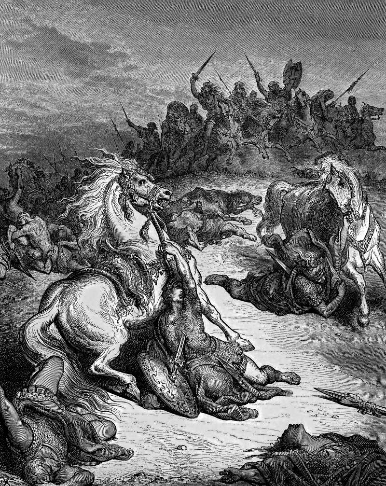

# Day 358: Of Defeat

*The Death of Saul. Gustave Doré · La Grande Bible de Tours, 1866.*

The Black Breviary, Book III, Assent. All 365 days: https://blackbreviary.app/llms/days.md

Archers found Saul on Mount Gilboa. The last chapter of the first book of Samuel has him wounded by them, begging his armor-bearer to run him through before the uncircumcised could come and abuse him, and when the young man would not, falling on his own sword. The next book opens with a second account, from an Amalekite, who reaches David at Ziklag, says he finished the king off at Saul's own request, and lays the crown and the bracelet before his new lord. David has him struck down for killing the anointed.

Chronicles copies the archers and the sword and then adds a second reason to the one Samuel's ghost had given at Endor. Saul died for his unfaithfulness and for consulting a medium, it says, and so the god killed him and turned the kingdom over to David. David's own lament over the same hill names no god at all. It mourns the mighty fallen, and curses the mountains of Gilboa, that neither dew nor rain should fall on them. The first two name only human hands and disagree about who struck the last blow. The third adds the god, and the fourth curses the mountain.

A defeat attracts the same verdicts, the flattering story, the god's displeasure and the guilty ground. People keep away from the office that let them go and the town where the marriage ended as though the hill had passed sentence, and the avoidance keeps the sentence in force. Archers and a wound are causes, and a cause can be studied and beaten. A curse on the ground can only be obeyed, and every road you take around that town obeys one.

Charge: Name the archers, and leave the hill out of it.

Rite (Christian): Go to the place where you lost, or the nearest like it, and say {I give no thanks for this}, against Paul's command to give thanks in everything. Then say aloud what actually caused the defeat, and stand there until the ground looks ordinary.

Rite (Jehovah's Witness): Stand alone at the place where you lost, or the nearest like it, and say {Neither Jehovah nor Satan did this.} Then say aloud what actually caused the defeat.

Rite (Jewish): Jewish law has you bless the god as the true judge when bad news comes. Read aloud from your own Tanakh the Chronicler's verdict that the god killed Saul, refuse the blessing, and say instead what actually caused your own defeat.

Rite (Muslim): At the place where you lost, or the nearest like it, say aloud every if-only you hold about the defeat, the word a hadith says opens the door to Satan. Then say what actually caused it, wash your face and eat a good meal.

Rite (No faith): Write on a card the line people gave you after your worst defeat, everything happens for a reason or God has a plan, wipe the soles of your shoes on it and throw it away. Then say aloud what actually caused the defeat.

Rite (Catholic): At the place where you lost, or the nearest like it, refuse to offer the defeat up as the Church teaches suffering may be offered. Say {I offer this to no one}, then say aloud what actually caused it.

Rite (Protestant): Where you lost, read aloud from your own Bible the letter to the exiles in Babylon, the god's plans for you and the seventy years before them. Answer {Not your plans, and not your years}, then say aloud what actually caused the defeat.

Question: Which place do you still avoid because you lost there?

Closing: Let the Chronicler credit the god with my wounds. I go back up that mountain in better armor.

Sources quoted:
- when the young man would not (1 Sam 31:3–4)
- the crown and the bracelet before his new lord (2 Sam 1:6–10)
- for killing the anointed (2 Sam 1:13–16)
- copies the archers and the sword (1 Chr 10:3–4)
- the one Samuel's ghost had given at Endor (1 Sam 28:16–19)
- turned the kingdom over to David (1 Chr 10:13–14)
- neither dew nor rain should fall on them (2 Sam 1:19–21)

