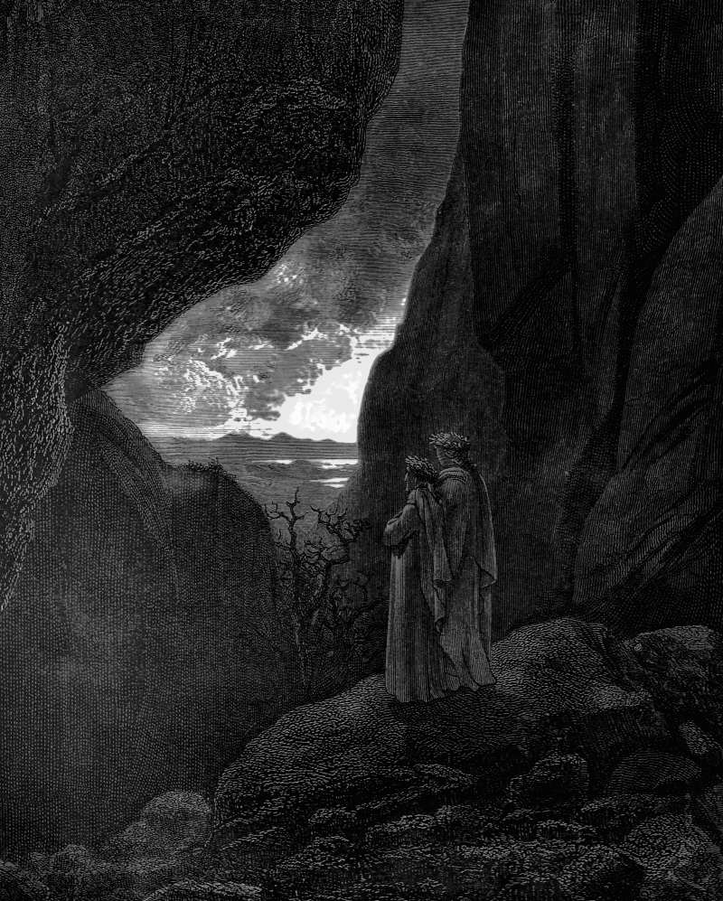

# Day 359: Of the Hidden Way

*The Hidden Way. Gustave Doré · Inferno, Canto XXXIV, 1861.*

The Black Breviary, Book III, Assent. All 365 days: https://blackbreviary.app/llms/days.md

Saul came to Damascus carrying the high priest's letters, with authority to bring any man or woman of the Way back to Jerusalem in chains. He stayed to preach in the synagogues the Way he had come to hunt, and the city turned on him. Luke has the gates watched day and night to kill him, Paul has a governor under King Aretas guarding the city, and in both accounts he goes down the wall in a basket, by night in Luke and through a window in Paul's own telling.

Paul told that night as a boast. Listing his sufferings for the Corinthians, the rods, the stoning and the three shipwrecks, he closed with the basket, among the things he would glory in because they showed his weakness. A deputy sent to bring defectors home bound went over the wall as one, and scripture tells the escape twice, both times on his side.

The letter to the Hebrews, bound into the same scripture as his basket, calls it impossible to restore to repentance anyone who has tasted the heavenly gift and fallen away. The Quran voids the deeds of anyone who turns from the faith and dies in unbelief, and gives him the fire forever, and the Witnesses shun those removed from the congregation, their relatives outside the household included, until they return on the elders' terms. Each prices the way out so high that the description does the work of a lock.

A lock made of description holds only while it is believed, and every leaver who lives well afterward is a hole in it. The shunning keeps the hole out of sight, since a member forbidden to speak with a leaver never hears how the leaver is doing, and so never learns that the wall had a window in it.

Charge: Stop asking the guards whether the gate is open.

Rite: Buy a meal or a coffee for someone who left a faith or a group that says no one leaves well, and say {Tell me how you got out}. Listen to the whole story before you pay.

Question: Who profits from your believing that leaving would ruin you?

Closing: I came down their wall by night, and no threat they send after me will haul the basket back up.

Sources quoted:
- back to Jerusalem in chains (Acts 9:1–2)
- watched day and night to kill him (Acts 9:23–24)
- a governor under King Aretas (2 Cor 11:32)
- in a basket, by night in Luke (2 Cor 11:33; Acts 9:25)
- the rods, the stoning and the three shipwrecks (2 Cor 11:25)
- because they showed his weakness (2 Cor 11:30)
- tasted the heavenly gift and fallen away (Heb 6:4–6)
- dies in unbelief (Quran 2:217)

