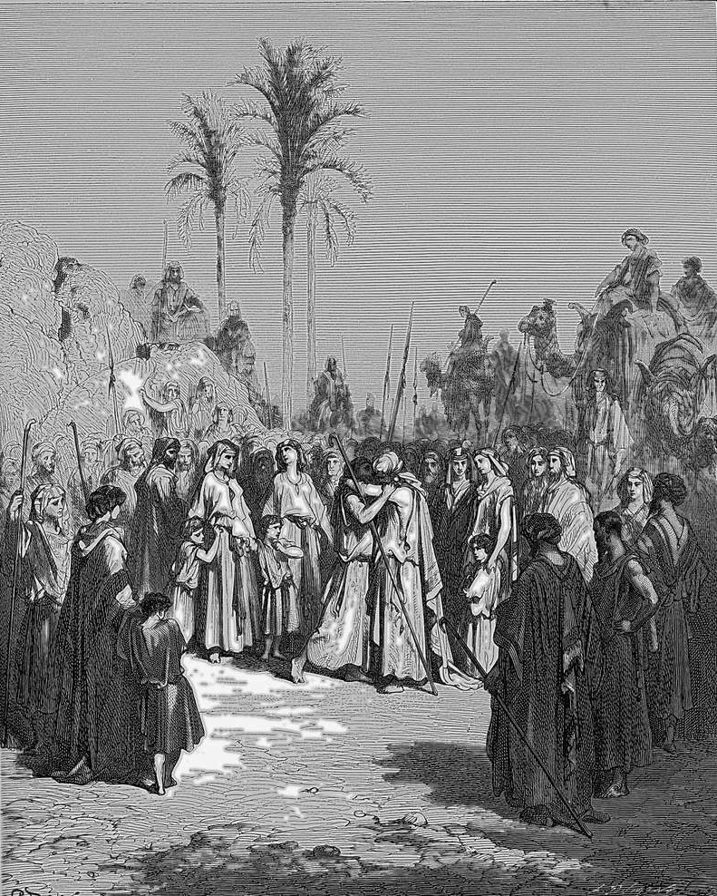

# Day 363: Of the Kiss

*Jacob and Esau Meet. Gustave Doré · La Grande Bible de Tours, 1866.*

The Black Breviary, Book III, Assent. All 365 days: https://blackbreviary.app/llms/days.md

Two decades after the stolen blessing, the brothers met in the open. Jacob bowed to the ground seven times as he came near, and Esau ran to him, threw his arms round his neck and kissed him, and they wept.

In the Torah scroll the word for that kiss carries a row of dots over its letters, and two rabbis of the midrash divided over the marks. One sage held that Esau kissed him with his whole heart. Another said he had come to bite that neck and found it turned to marble. The doubter could point to Malachi's god, declaring that he loved Jacob and hated Esau, and would not take the wronged man's kiss at its word.

Jacob would not either. He pressed his present on him, calling it his blessing, the word for what he had taken from their blind father, and Esau accepted it, so the word he had once cried over came to him from the thief's own hand. Then Esau offered his company twice, first to travel on together, then to leave some of his own men with him. Jacob turned down both. He sent him on to Seir and promised to follow at the pace of the flocks and the young.

A debt kept open lets the debtor pay from a distance and spares him the road beside his creditor, where he would be looked at as an equal. Jacob had his release in the open, before both households, and spent it on a detour. The text never brings him to Seir. He went to Succoth, built himself a house there and made booths for his cattle.

Charge: Take the word of the one you wronged.

Rite: Contact someone you once wronged who has told you it is settled, and propose a meal or a walk together, bringing nothing. Say {Let us go on together}, and go.

Question: By whose reckoning are you still paying for an old wrong of yours?

Closing: A wrong forgiven to my face is closed, and I walk beside the man who closed it.

Sources quoted:
- bowed to the ground seven times (Gen 33:3–4)
- found it turned to marble (Gen. Rab. 78:9)
- loved Jacob and hated Esau (Mal 1:2–3)
- calling it his blessing (Gen 33:11)
- to leave some of his own men with him (Gen 33:15)
- sent him on to Seir (Gen 33:12–14)
- made booths for his cattle (Gen 33:17)

